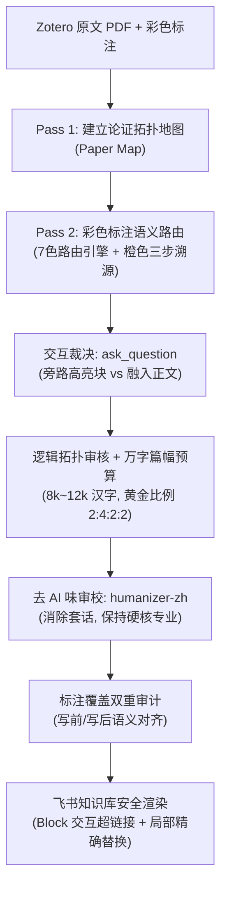

# Zotero → 飞书论文笔记 (zotero-feishu-paper-notes)

> **专为学术研究者与硬件/芯片/AI 架构师打造的深度精读 Agent 技能。**  
> 支持 **Claude Code**、**OpenAI Codex** 与 **Google Antigravity / Gemini**。

从 **Zotero Desktop 本地文献库** 与 **论文原 PDF** 中完整精读单篇学术论文，深度融合读者留下的**彩色划线、文本批注、批判性疑问与延伸线索**。先还原论文原生论述逻辑与因果接力链，再利用 `ask_question` 与用户交互决策排版形态，经过 `humanizer-zh` 去 AI 腔调审校，最终安全输出/增量更新至**飞书知识库**。

---

## 核心设计哲学

1. **先原文全貌，后标注叠加**：严禁仅阅读摘要或高亮碎片；必须先建立整篇论文的因果论证地图（Paper Map），标注仅决定关注权重，不篡改论文原生论述链。
2. **读者思考最大化保真**：读者留下的文字批注、反例推导与架构批判是笔记的核心灵魂。保留原话术语与思考逻辑，严禁被 AI 概括平铺抹杀。
3. **独立局限性章节独立完整总结**：原论文设有独立 Limitations 章节时，必须在笔记中单列小节系统总结，严禁拆碎稀释融入正文。
4. **防御性安全写入**：对已存在的飞书文档，后续局部修改强制使用唯一文本片段级改写（`str_replace`），严禁使用整篇 `overwrite` 或跨层级 `block_replace`，杜绝覆盖用户在网页端的人工编辑。

---

## 六大核心特性



### 1. 🌈 认知级彩色标注路由 (Annotation Routing)
- **蓝色 (`#2ea8e5`) & 黄色 (`#ffd400`)**：共同构成正文主线，按重要度适度加粗或制表强调。
- **紫色 (`#a28ae5`) / 洋红 (`#e56eee`)**：保留读者问题意图与思考线索，紧邻补全完整机制解答，闭合认知环。
- **绿色 (`#5fb236`)**：论文缺陷与局限。若论文含独立 Limitations 章节，强制在第三章独立总结，拒绝稀释。
- **红色 (`#ff6666`)**：疑似论文错误，还原公式与数据，后台以反例或推导复核，存疑点就地说明。
- **橙色 (`#f19837`) · 三步溯源与反观法**：
  $$\text{锚定语境意图} \longrightarrow \text{检索被引文献底层机理 (The Former)} \longrightarrow \text{反观本篇折中与局限 (The Latter)}$$
  提炼为独立闭环技术专题，收敛入“第四章：待深入与可追溯线索”。

### 2. 💬 呈现形态交互决策机制 (Interactive UI Decision)
对于具有呈现双重性（可作正文逻辑段，亦可作独立高亮块）的高价值复杂批注，Agent 会在成文计划前主动调用 `ask_question` 工具向用户发起提问，提供专业倾向建议（`(Recommended)`），由用户裁决是融入正文、做成 `💡 关键理解` 高亮块还是 `🔍 存疑` 提示块。

### 3. 📏 万字篇幅预算控制 (Word Budget Constraints)
- **顶会论文（正文 10~14 页）黄金标准**：**8,000 ~ 12,000 汉字**。
- **2:4:2:2 黄金比例**：背景 (1.5k~2k) : 核心微架构与算法 (4k~5k) : 实验评估与局限 (2k~2.5k) : 待深入专题 (1.5k~2k)。

### 4. 👥 大部长文多 Agent 协同架构 (Multi-Agent Chapter-split)
针对 >15 页或 >50 条高密批注的超大论文，可由**主编排 Agent**（负责全局论证拓扑与统一飞书写入权）调度 4 个**章节专员**（背景、架构、评估、线索）受限字数并行深入精读，最终收敛终审。

### 5. 🔗 图表 Block 原生交互超链接 (Interactive Anchor Links)
正文中所有提及的“图 x”、“表 y”，均原生转换为指向飞书 Block ID 的超链接（`<a href="...#block_id">图 x</a>`），点击平滑跳转高亮，保障数万字沉浸式阅读心流。

### 6. 🛡️ 去 AI 味审校与双重覆盖审计
- 强制调用 `humanizer-zh` 剔除“综上所述”、“值得注意的是”等无信息填充词，杜绝假大空排比；
- 写前、写后两次逐条核查 7 种标注覆盖状态，确保零遗漏。

---

## 目录结构

```text
zotero-feishu-paper-notes/
├── SKILL.md                              # 核心入口规范与质量门禁
├── README.md                             # 项目说明文档
├── scripts/
│   └── extract_zotero_annotations.py    # 只读提取 Zotero 本地 API 标注脚本
└── references/
    ├── paper-reading-workflow.md         # 双遍精读流程与逻辑映射审核
    ├── annotation-routing.md             # 7色标注路由、三步溯源与 ask_question 协议
    ├── source-grounding.md               # 技术核验、硬件规范与反例推导原则
    ├── writing-style.md                  # 篇幅预算、图表锚点与去 AI 味指南
    ├── note-template.xml                 # 飞书 XML 笔记标准骨架模板
    ├── annotation-audit.md               # 标注双重语义覆盖审计表
    └── style-examples.md                 # 优质与劣质写作对比实操样例
```

---

## 快速上手与前置依赖

### 1. 前置依赖

#### (1) 本地软件与运行环境
- **Zotero Desktop**：保持在本地运行，并开启本地 Web API（默认端口 `http://127.0.0.1:23119`）；
- **Python 3.8+**：用于运行 `extract_zotero_annotations.py` 提取脚本（零第三方依赖，纯标准库）。

#### (2) 依赖的 Agent 技能与工具链 (Skills & CLIs)
本技能在完整工作流中与以下专职 Skill 协同配合，请确保环境中已安装可用：
- **`zotero` 技能**：负责探测本地 Zotero 状态、文献库搜索与条目解析；
- **`lark-cli` 系列技能**（包含 `lark-doc`、`lark-drive`、`lark-shared`）：负责飞书开放平台鉴权、知识库检索、文档 XML 标准草稿渲染、Block 级读取与 `str_replace` 防御性局部修改；
- **`humanizer-zh` 技能**：中文“去 AI 味”专用审校 Skill，在笔记初稿完成后负责消除无信息空话、机械排比与夸大形容词，保持严谨学术气质。

### 2. 跨平台安装指引

#### (1) Claude Code
克隆到 Claude 个人技能目录：
```bash
git clone https://github.com/Passionate0424/zotero-feishu-paper-notes.git ~/.claude/skills/zotero-feishu-paper-notes
```

#### (2) OpenAI Codex / Agents
通过 Windows Junction 或软链接直接复用 Claude 目录，实现免维护实时同步：
```powershell
New-Item -ItemType Junction -Path "$HOME\.codex\skills\zotero-feishu-paper-notes" -Target "$HOME\.claude\skills\zotero-feishu-paper-notes"
```

#### (3) Google Antigravity / Gemini
因为 Antigravity 沙箱安全隔离机制限制，建议直接保留物理目录：
```bash
git clone https://github.com/Passionate0424/zotero-feishu-paper-notes.git ~/.gemini/config/skills/zotero-feishu-paper-notes
```

---

## 常用交互指令示例

在与 AI Agent 对话时，可直接通过以下方式调起本技能：

- **阶段一：阅读总结与答疑**
  > `/zotero-feishu-paper-notes 阅读 Zotero 中的论文《FlightVGM》，梳理全文主线并回答我的紫色批注。`
- **阶段二：制定笔记大纲与交互排版**
  > `/zotero-feishu-paper-notes 针对刚才的论文制定飞书笔记计划，针对关键批注给出排版建议并向我提问。`
- **阶段三：正式撰写与飞书写入**
  > `/zotero-feishu-paper-notes 按大纲正式撰写笔记，执行 humanizer-zh 语言审校与覆盖审计，写入飞书知识库。`
- **阶段四：局部安全修订**
  > `请把飞书文档中关于“离线 Tag 机制”的推导做一下文字修改，注意使用片段级安全替换。`

---

## 开源协议

本项目采用 [MIT License](LICENSE) 开源协议。
