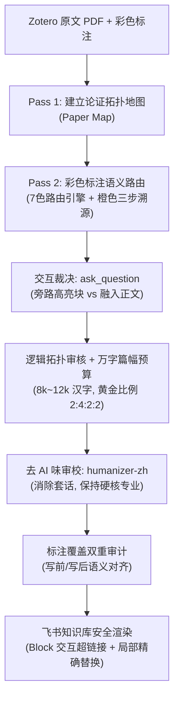

# Zotero → 飞书论文笔记 (zotero-feishu-paper-notes)

> **专为学术研究者与硬件/芯片/AI 架构师打造的深度精读 Agent 技能。**  
> 支持 **Claude Code**、**OpenAI Codex** 与 **Google Antigravity / Gemini**。

从 **Zotero Desktop 本地文献库** 与 **论文原 PDF** 中完整精读单篇学术论文，深度融合读者留下的**彩色划线、文本批注、批判性疑问与延伸线索**。先还原论文原生论述逻辑与因果接力链，再利用 `ask_question` 与用户交互决策排版形态，经过 `humanizer-zh` 去 AI 腔调审校，最终安全输出/增量更新至**飞书知识库**。

---

## 核心设计哲学

1. **先原文全貌，后标注叠加**：严禁仅阅读摘要或高亮碎片；必须先建立整篇论文的因果论证地图（Paper Map），标注仅决定关注权重，不篡改论文原生论述链。
2. **读者思考最大化保真**：读者留下的文字批注、反例推导与架构批判是笔记的核心灵魂。保留原话术语与思考逻辑，严禁被 AI 概括平铺抹杀。
3. **独立局限性章节独立完整总结**：原论文设有独立 Limitations 章节时，必须在笔记中单列小节系统总结，严禁拆碎稀释融入正文。
4. **综述自适应分类体系**：对于综述型论文（Survey / Review），打破固定四大章节教条，直接按原著分类学（Taxonomy）与逻辑脉络构建章节，适当控制字数，确保简洁高效。
5. **开篇主线、贡献、局限与思维导图**：开篇标配因果递进的 `🎯 论文主线`（250~400字）、直接对齐原著自述的 `💡 核心贡献概括` 清单；若论文分析了局限性，紧跟其后呈现 `⚠️ 核心局限性概括`；配合飞书原生画板思维导图（`<whiteboard type="mermaid">` 内置 `mindmap`），动静互补，全景、交付物与技术边界一览无余。
6. **防御性安全写入**：对已存在的飞书文档，后续局部修改强制使用唯一文本片段级改写（`str_replace`），严禁使用整篇 `overwrite` 或任何 `block_replace`，杜绝覆盖用户在网页端的人工编辑。
7. **飞书公式与符号原生渲染**：彻底杜绝 Markdown 裸 `$` 导致的公式渲染失败；数学推导严格使用飞书原生 `<latex>` 标签并转义 `\gt`、`\lt`，软硬件参数与代码符号统一采用 `<code>` 等宽徽章，确保符号原汁原味与 XML 解析零崩溃。

---

## 六大核心特性



### 1. 🌈 认知级彩色标注路由 (Annotation Routing)
- **蓝色 (`#2ea8e5`) & 黄色 (`#ffd400`)**：构成正文主线（强调程度黄色大于蓝色，各颜色内高亮高于下划线），高优先级内容适度加粗或制表强调。
- **紫色 (`#a28ae5`) / 洋红 (`#e56eee`)**：保留读者问题意图与思考线索，紧邻补全完整机制解答，闭合认知环。
- **绿色 (`#5fb236`)**：论文缺陷与局限。若论文含独立 Limitations 章节，强制在第三章独立总结，拒绝稀释。
- **红色 (`#ff6666`)**：疑似论文错误，还原公式与数据，后台以反例或推导复核，存疑点就地说明。
- **橙色 (`#f19837`) · 逢橙必派独立 Subagent 搜索 + 三步溯源与多轮追问**：
  $$\text{下发三联上下文包} \longrightarrow \text{独立 Subagent 检索被引机理 (The Former)} \longrightarrow \text{反观本篇折中 (The Latter)} \longrightarrow \text{主 Agent 质询与多轮搜索确认}$$
  独立于全文篇幅判断（哪怕单 Agent 精读中短篇论文），凡有橙色标注均强制派生专职 Subagent 隔离搜索噪音，支持主 Agent 多轮追问深挖，最终提炼为闭环专题。

### 2. 💬 呈现形态交互决策机制 (Interactive UI Decision)
**全量橙色标注（`#f19837`）强制必问**落点走向（收敛至第四章独立专题 vs 就近旁路提示块），同时对具有呈现双重性的高价值复杂批注（复合紫色、架构对比、红色存疑），在成文计划前由 Agent 调用 `ask_question` 工具集中向用户发起提问，提供专业倾向建议（`(Recommended)`），由用户拥有最终版面裁决权，严禁 AI 擅自代行决策。

### 3. 📏 万字篇幅预算控制 (Word Budget Constraints)
- **顶会论文（正文 10~14 页）黄金标准**：**8,000 ~ 12,000 汉字**。
- **2:4:2:2 黄金比例**：背景 (1.5k~2k) : 核心微架构与算法 (4k~5k) : 实验评估与局限 (2k~2.5k) : 待深入专题 (1.5k~2k)。

### 4. 👥 长文多 Agent 三步双向闭环与多轮质询编排 (Bi-directional Subagent Orchestration)
针对正文 $>15$ 页、批注 $>35$ 条或复杂综述，主 Agent 先通过 `ask_question` 向用户建议开启多 Agent 模式，并依据论文实际结构动态择优切分：
- **“1 全局 + N 局部”角色互补**：必配 `Subagent-0`（全文脉络专员）通观全篇把握“森林”（全局叙事链、跨节隐性耦合、统一符号表、跨页疑问定位），搭配若干局部专员分段深潜死磕“树木”（公式、微架构、实验与批注细节）；
- **三步走双向闭环 + 多轮追问确认**：① 子 Agent 精读上报《情报卡》 $\rightarrow$ ② 主 Agent 全局统筹、对存疑/浅层点发起 `send_message` 多轮追问重查、向用户发起 `ask_question` 排版裁决并复用原 Subagent 下发《定稿提炼指令单》 $\rightarrow$ ③ 局部专员凭脑中原文细节写高保真章节血肉，主 Agent 撰骨缝合、统一执行 `humanizer-zh` 润色与标注审计后写入飞书。

### 5. 🔗 图表 Block 原生交互超链接 (Interactive Anchor Links)
正文中所有提及的“图 x”、“表 y”，均原生转换为指向飞书 Block ID 的超链接（`<a href="...#block_id">图 x</a>`），点击平滑跳转高亮，保障数万字沉浸式阅读心流。

### 6. 🛡️ 去 AI 味审校与双重覆盖审计
- 强制调用 `humanizer-zh` 剔除“综上所述”、“值得注意的是”等无信息填充词，杜绝假大空排比；
- 写前、写后两次逐条核查 7 种标注覆盖状态，确保零遗漏。

### 7. 🧠 综述自适应架构与开篇飞书原生思维导图
- **综述论文特化模式**：对于 Survey / Review 论文，自动解除研究型论文的四大章节限制，直接提取原著 Taxonomy 逻辑分节，篇幅预算 8,000 ~ 15,000 汉字，简洁清晰地概述核心分类与代表作；
- **原生画板思维导图**：开篇通过 `<whiteboard type="mermaid">` 注入标准 `mindmap`，飞书文档直接渲染为原生可交互画板思维导图，全景导航一目了然。

---

## 目录结构

```text
zotero-feishu-paper-notes/
├── SKILL.md                              # 核心入口规范与质量门禁
├── README.md                             # 项目说明文档
├── scripts/
│   └── extract_zotero_annotations.py    # 只读提取 Zotero 本地 API 标注脚本
└── references/
    ├── paper-reading-workflow.md         # 双遍精读流程、技术/红绿核验准则与逻辑映射审核
    ├── subagent-orchestration.md         # 多 Agent 三步双向闭环编排与独立橙色搜索协议
    ├── annotation-routing.md             # 7色标注路由、三步溯源与 ask_question 协议
    ├── writing-style.md                  # 篇幅预算、图表锚点与去 AI 味指南
    ├── note-template.xml                 # 飞书 XML 笔记标准骨架模板
    ├── annotation-audit.md               # 标注双重语义覆盖审计表
    └── style-examples.md                 # 优质与劣质写作对比实操样例
```

---

## 快速上手与前置依赖

### 1. 前置依赖

#### (1) 本地软件与运行环境
- **Zotero Desktop**：保持在本地运行，并开启本地 Web API（默认端口 `http://127.0.0.1:23119`）；
- **Python 3.8+**：用于运行 `extract_zotero_annotations.py` 提取脚本（零第三方依赖，纯标准库）。

#### (2) 依赖的 Agent 技能与工具链 (Skills & CLIs)
本技能在完整工作流中与以下专职 Skill 协同配合，请确保环境中已安装可用：
- **`zotero` 技能**：负责探测本地 Zotero 状态、文献库搜索与条目解析；
- **`lark-cli` 系列技能**（包含 `lark-doc`、`lark-drive`、`lark-shared`）：负责飞书开放平台鉴权、知识库检索、文档 XML 标准草稿渲染、Block 级读取与 `str_replace` 防御性局部修改；
- **`humanizer-zh` 技能**：中文“去 AI 味”专用审校 Skill，在笔记初稿完成后负责消除无信息空话、机械排比与夸大形容词，保持严谨学术气质。

### 2. 跨平台安装指引

#### (1) Claude Code
克隆到 Claude 个人技能目录：
```bash
git clone https://github.com/Passionate0424/zotero-feishu-paper-notes.git ~/.claude/skills/zotero-feishu-paper-notes
```

#### (2) OpenAI Codex / Agents
通过 Windows Junction 或软链接直接复用 Claude 目录，实现免维护实时同步：
```powershell
New-Item -ItemType Junction -Path "$HOME\.codex\skills\zotero-feishu-paper-notes" -Target "$HOME\.claude\skills\zotero-feishu-paper-notes"
```

#### (3) Google Antigravity / Gemini
因为 Antigravity 沙箱安全隔离机制限制，建议直接保留物理目录：
```bash
git clone https://github.com/Passionate0424/zotero-feishu-paper-notes.git ~/.gemini/config/skills/zotero-feishu-paper-notes
```

---

## 常用交互指令示例

在与 AI Agent 对话时，可直接通过以下方式调起本技能：

- **阶段一：阅读总结与答疑**
  > `/zotero-feishu-paper-notes 阅读 Zotero 中的论文《FlightVGM》，梳理全文主线并回答我的紫色批注。`
- **阶段二：制定笔记大纲与交互排版**
  > `/zotero-feishu-paper-notes 针对刚才的论文制定飞书笔记计划，针对关键批注给出排版建议并向我提问。`
- **阶段三：正式撰写与飞书写入**
  > `/zotero-feishu-paper-notes 按大纲正式撰写笔记，执行 humanizer-zh 语言审校与覆盖审计，写入飞书知识库。`
- **阶段四：局部安全修订**
  > `请把飞书文档中关于“离线 Tag 机制”的推导做一下文字修改，注意使用片段级安全替换。`

---

## 开源协议

本项目采用 [MIT License](LICENSE) 开源协议。
